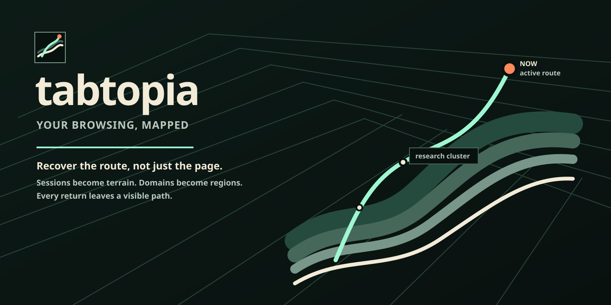
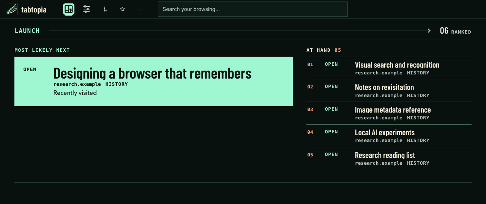
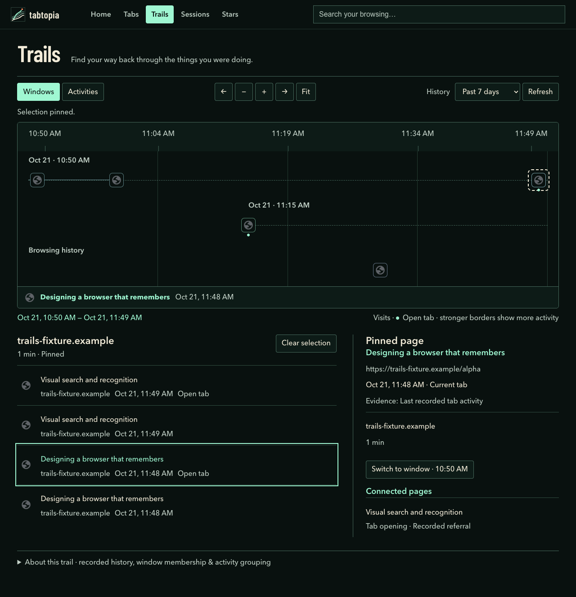

  

# Tabtopia

**Recover the route, not just the page.**

Tabtopia is an experimental Chrome extension for finding your way back through
your browsing. It brings together visual history, predictive revisit models,
page imagery, and AI: remember a page by the image you saw, retrace the research
that led to it, or give your agent the context of the tabs already open.

- **Resume and rediscover.** Home surfaces destinations from browsing history
  and bookmarks; Trails reveals visits, branches, and returns across windows.
- **Explore predictive revisitation.** Local experiments combine patterns in
  past visits with current tab context to estimate where you might go next.
- **Recognize pages visually.** Extracted hero images and favicons put familiar
  visual cues alongside titles and browsing sessions.
- **Bring AI into the loop.** Chrome's on-device AI can summarize page content.
  An optional MCP companion lets your agent read your current browser context.

[Install Tabtopia](#install) · [Explore the features](#find-your-way-back) ·
[Connect an agent](#give-your-agent-browser-context) · [Permissions and privacy](#permissions-and-privacy)

*Home in the development build, rendered with synthetic example destinations.
This illustrates the interface, not a measured prediction result.*

## Install

Download `tabtopia-v*.zip` from [Releases](https://github.com/andyed/tabtopia/releases)
and unzip it, or clone this repository to try the current development source.

1. Open `chrome://extensions/` and enable **Developer mode**.
2. Choose **Load unpacked** and select the folder containing `manifest.json`.
3. Open a new tab to enter Tabtopia. Pin its toolbar icon for quick tab access.

**Tabtopia replaces Chrome's new-tab page.** The extension works without Node.js,
an agent, or a local server. Review [site access](#hero-images-and-site-access)
if you want page imagery and content extraction across the sites you visit.

The latest published release is **v1.4.0**. This README describes the current
development source, including Trails and newer prediction experiments; release
builds can differ. Check the release notes for what a download includes. After
updating an unpacked extension, click **Reload** in `chrome://extensions/`.

### Try it

- Type **`tt`**, press **Space**, and search for a tab from Chrome's address bar.
- Open **Home** to pick up a destination from your browsing and bookmarks.
- Open **All tabs** to explore the treemap. Hover to preview, click to pin a
  readout, and double-click or press Enter to switch to the selected tab.
- Open **Trails** to inspect visits and returns over a day, week, or month.
- Visit and scroll through a few pages. As imagery is collected, **Sessions**
  gains visual reminders of the pages you spent time with.

## Find your way back

| View | What it helps you do |
|---|---|
| **Home** | Resume from suggested destinations, recent activity, and bookmarks. Works from your local browser data without an interest-profile service. |
| **All tabs** | See open tabs as a treemap, inspect a page's readout, and move between tabs and windows. |
| **Trails** | Follow recorded visits along window timelines or grouped activities; inspect the pages and connections behind a return. |
| **Sessions** | Revisit a browsing episode through its pages, navigation graph, and extracted imagery. |
| **Stars** | Find saved bookmarks alongside the browsing context around the time you saved them. |

*Trails in the development build, with synthetic browsing history. Repeated visits
remain visible; selecting a page pins its details while you explore.*

Trails supports zoom, pan, and **Fit**. Focus the timeline and use Left/Right,
+/−, or Home. Hover previews; selection stays pinned; Escape clears it.
**Open page**, **Go to tab**, and **Switch to window** are explicit actions.
Windows show the current membership of tabs; historical visits without window
evidence appear in a separate history lane.

### Experimental predictive revisitation

Tabtopia explores a more ambitious question than “what did I open recently?”:
**given where I am now and how I have returned to pages before, where might I go next?**

The revisit model combines a time-decaying history of qualified visits with
observed transitions between pages and sites. The next-tab study also evaluates
a learned model that combines revisit scores with recency, time spent, window
membership, and tab position. Its fitted weights ship with the extension;
it does not retrain itself continuously in your browser.

Models are evaluated locally against simple baselines such as most-recently-used
and frequency-plus-recency ranking. The study records predictions before the
next observed tab choice, allowing comparison without automatically moving you.
The experiment's exposure criteria consider outcome counts, performance across
time windows, coverage, and calibration.

**This is experimental, not a claim of proven gains for every browser or user.**
Home's visible recommendations have their own heuristic policy over history,
bookmarks, and optional context; they should not be mistaken for the learned
next-tab model's output. The MCP tab briefing has a simpler ordering again:
recorded time spent, with recency breaking ties.

Open **Options → Help improve tab ranking** to control local evaluation and
inspect results. Unpacked installs—including the ZIP installation above—default
to evaluation on unless you have saved a different choice. Disabling it clears
the associated study records. Prediction replay stores numeric candidate
features rather than page titles, URLs, or query text; ordinary browsing records
are a separate store.

See the [prediction replay guide](docs/PREDICTION_REPLAY.md),
[revisit implementation](src/lib/revisit-model.js), and
[learned model](src/lib/learned-combiner.js) for the mechanics.

### Hero images and site access

A remembered photograph or illustration can be a useful way back to a page.
Tabtopia looks for representative images in Open Graph and Twitter metadata and
in the page's images, then uses those references in session cards and mosaics.
These are images from the pages you visit, not generated pictures or screenshots
of your browser.

Automatic collection uses time-on-page and scrolling thresholds. It normally
checks after about a minute and more than 500 pixels of scrolling, with a
best-effort collection on exit after shorter engagement. Not every page provides
a usable image, and a previously saved image URL can stop working.

This needs access to page content. The extension declares `<all_urls>` site
access and matching content scripts so it can inspect image metadata, images,
and navigation context on the sites you visit. **To enable automatic collection
across sites**, open Tabtopia's details in `chrome://extensions/` and allow site
access on all sites. If you restrict access to selected sites or on-click access,
collection is limited to pages where Chrome permits the extension to run.
Reload an already-open page after granting access so its content scripts load.

Tabtopia stores image URLs and metadata locally. The Wunderkammer gallery also
keeps a bounded local thumbnail cache for faster repeat visits; clearing hero
metadata clears those thumbnails. Displaying an image can request
it from its original website or CDN; local storage does not mean every image is
available offline. Broad site access also enables other page-context features—it
is not an image-only permission. Chrome's
[permission guide](https://developer.chrome.com/docs/extensions/develop/concepts/declare-permissions)
explains how host access and content scripts work.

### On-device AI summaries

When available, Chrome's built-in Summarizer produces a short summary of page
content in the readout. It runs on-device; it does not need a separate AI account
or the MCP companion. Availability depends on Chrome, supported hardware, and
the model being downloaded. See Chrome's
[Summarizer requirements](https://developer.chrome.com/docs/ai/summarizer-api).

When summarization is unavailable or fails, Tabtopia falls back to page metadata
and heuristic descriptions. Those fallbacks are not AI summaries, and summaries
are not a guarantee that the entire page was captured.

## Give your agent browser context

Ask **“What am I looking at?”**, **“Find the tab about image metadata”**, or
**“Save this research context.”** The optional MCP companion lets an agent find
open tabs, see recent navigation, and read a requested page—including accessible
logged-in content that a plain web fetch cannot see.

For example, with a bakery menu open, ask “Does this bakery have quiche?” The
agent can find the tab and read the menu without you copying its URL. Responses
include snapshot age so the agent can distinguish a fresh view from stale context.

| Tool | Purpose |
|---|---|
| `get_context` | Focused tab, tabs ranked by recorded time spent, audio state, and recent navigation. |
| `search` | Find open tabs, recent activity, or saved context snapshots. |
| `capture_context` | Save a named snapshot of the current browser working state. |
| `get_tab_content` | Read an open tab as text, a semantic outline, or labelled controls. |

The MCP does not open, close, focus, or navigate tabs. Capturing a snapshot writes
local data; page reads are read-only. Page-derived text is marked untrusted so
agents can distinguish page content from instructions.

**Setup:** install the extension first, then follow the
[MCP guide](mcp/README.md) to install its Node dependency, start the local bridge,
and register the server with your MCP client. The extension is required; it is
also the browser sensor. Optional `browser-now` skills help
[Codex and other skill clients](.agents/skills/browser-now/SKILL.md) and
[Claude Code](.claude/skills/browser-now/SKILL.md) know when to use the tools.
Other clients can use the [agent guidance](mcp/USAGE-FOR-AGENTS.md).

## Permissions and privacy

Tabtopia's browsing records live in Chrome's local extension storage. They can
include page URLs and titles, navigation relationships, time spent, image
references, and captured search queries. The extension uses that context to make
browsing history searchable and visually recognizable.

| Access declared by the extension | What it supports |
|---|---|
| Site access (`<all_urls>` and content scripts) | Extract page imagery and metadata; observe navigation context on permitted pages. |
| `history`, `bookmarks` | Find visits and saved pages, reconstruct context, and rank destinations. |
| `tabs`, `windows` | Track open tabs and windows and switch to a destination you select. |
| `storage` | Keep browsing context, preferences, image references, and study data locally. |
| `webNavigation`, `webRequest` | Observe navigation and request context, including redirects and referrers. |
| `activeTab`, `scripting` | Support page-content extraction for readouts and requested MCP reads. |
| `favicon` | Display site icons. |
| `ai` | Declared for the built-in AI integration; model availability is checked separately. |

The default MCP bridge listens on loopback and restricts extension WebSocket
connections by Origin. **An agent client can send tool results to its model
provider.** Using a local bridge does not make a cloud-backed agent local; choose
clients and models according to the pages you want them to read.

Images and optional public feeds can make external network requests. Optional
local companion services have their own data handling. For recorded fields,
retention, deletion, and remaining policy decisions, read the
[working privacy notes](PRIVACY.md).

## Documentation and feedback

- [Development and troubleshooting](docs/DEVELOPMENT.md)
- [MCP setup, architecture, and security boundary](mcp/README.md)
- [Prediction replay and model evaluation](docs/PREDICTION_REPLAY.md)
- [Tests and browser fixtures](tests/README.md)
- [Changelog](CHANGELOG.md) · [License](LICENSE)

[Report a bug or share a use case](https://github.com/andyed/tabtopia/issues).
Include your Chrome and Tabtopia versions, the view involved, and steps to
reproduce. Review logs and screenshots for private browsing information before
posting them.

Tabtopia is an ongoing exploration of browsing, memory, and visual interfaces,
built with substantial AI-assisted development and human direction and testing.
